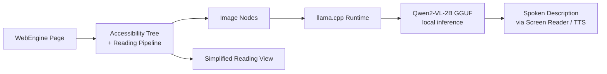

  
  
  
  

<b>Language:</b> English | <a href="#中文版">中文</a>

## 🧑‍💻 About Me

I am an **accessibility-first developer**. I build tools for blind and low-vision users — and, more importantly, I build them *with* blind and low-vision users: a real user community on Xiaohongshu and WeChat tests my builds, files issues and argues about details with me. That feedback loop is my actual development method.

My work lives at the intersection of three things:

- **Assistive products** — browsers, OCR readers and navigation aids designed for screen-reader and voice-first workflows from day one
- **On-device AI** — vision and language models that run locally (TensorFlow Lite, llama.cpp / GGUF), because assistive tools must work offline and must never upload what a user is looking at
- **Systems underneath** — Linux, Docker, and hands-on enterprise server hardware (rack servers, RAID, BMC remote management), so the products above rest on skills I have actually practiced

> A visually impaired user once described what she wanted from image description in five words: *"I just want to know what's in the picture."* That sentence is the spec for most of what I build.

---

## 🚀 Featured Projects

### 🌐 Intelnet Browser （明镜浏览器） — *main project*

A desktop browser designed from the start for screen-reader and low-vision users. Accessibility here is the architecture, not a plugin.

- **Local image description** — Qwen2-VL-2B-Instruct in GGUF form (llama.cpp runtime), fully on-device. The image never leaves the computer.
- **Reading pipeline** — page simplification, element translation and reading order tuned for assistive navigation
- **Distribution** — installers served from Cloudflare R2, site and docs at [guangji.online](https://guangji.online)
- **License** — GPLv3, deliberately: assistive tooling built on public work should stay public

### 👁️ [guide](https://github.com/RUV2005/guide) — spatial awareness for blind users

Real-time object detection on Android that answers two questions for a blind user: *what is around me, and in which direction?*

- On-device detection (TensorFlow Lite), no network dependency outdoors
- Direction-aware feedback: results are mapped to clock-face directions and delivered by voice + vibration patterns
- Designed for one-handed, eyes-free operation

### 📖 [mingmou](https://github.com/RUV2005/mingmou) — OCR reading assistant

Reading assistant for low-vision users, built for classrooms and paper books.

- Hybrid recognition: cloud OCR when online, on-device OCR when not
- External camera support: an ESP32-CAM streams over its own access point, so the phone can stay in a pocket while the camera sits on the book
- Voice-first UI throughout

### 🎵 [Kalimba](https://github.com/RUV2005/Kalimba) — accessible music practice

A kalimba practice app whose entire interface can be operated by voice and gesture alone — practice, tuning feedback and progress tracking without looking at the screen.

---

## 🧰 Technical Toolbox

   
  

| Domain | What I actually work with | Evidence |
|---|---|---|
| Android | Kotlin, CameraX, TensorFlow Lite, accessibility services | guide, mingmou, Kalimba |
| iOS / macOS | Swift, SwiftUI, Speech framework, sideload CI pipelines | caption tooling, SwiftUI apps |
| Desktop | C++ / Qt WebEngine, C# / WPF | Intelnet Browser, Windows utilities |
| On-device AI | llama.cpp / GGUF, TFLite, model quantization trade-offs | local image description in production |
| Systems & Ops | Linux, Docker, server hardware, RAID, BMC remote management | hands-on with enterprise rack servers (hardware, install, troubleshooting) |
| Hardware | PCB design (KiCad, learning in public), ESP32, board-level repair | caption glasses prototype |

---

## 📊 Development Analytics

---

## 🧭 Current Trajectory

| Direction | Status |
|---|---|
| Intelnet Browser: local image description | ✅ shipped, iterating with user feedback |
| Intelnet Browser: captions for any video, generated in the browser itself | 🔨 in development |
| Real-time caption glasses (phone-side speech-to-text + custom PCB hardware) | 🔨 prototyping |
| Kubernetes & cloud-native ops | 🌱 learning on my laptop (WSL + k3d + VMs) |
| PCB design, KiCad → first self-designed power board | 🌱 learning |

---

## 📣 Contact

- **Email:** danmo6321@gmail.com
- **Site:** [guangji.online](https://guangji.online)
- **Issues & ideas:** the fastest way to reach me about any project is opening an issue in its repo

---

## 中文版

你好，我是 Danmo，一名以无障碍为先的开发者。

我给视障用户做工具，而且是和他们一起做：小红书和微信上有真实的视障用户社群在测我的版本、提 issue、跟我争细节。这个反馈闭环就是我的开发方法。

### 主要项目

- **明镜浏览器（intelnet-browser）**：主线项目。为读屏和低视力用户从架构层设计的桌面浏览器，核心是完全本地运行的图片描述（Qwen2-VL GGUF 模型，图片不出设备），GPLv3 开源，官网 guangji.online。
- **guide**：给盲人用的实时物体识别，回答“周围有什么、在哪个方向”，语音加震动反馈，全程本地推理。
- **mingmou（明眸）**：给低视力用户的 OCR 阅读助手，读课件、黑板和纸书，可接 ESP32-CAM 外置摄像头。
- **Kalimba**：全语音界面的卡林巴练习应用。

### 技术面

Android（Kotlin）、iOS（Swift / SwiftUI）、桌面端（C++ / Qt、C# / WPF）、端侧 AI（TensorFlow Lite、llama.cpp / GGUF）、Linux 与服务器运维（有企业级机架服务器的拆装、装机与排障实操），目前在自学 PCB 设计和 Kubernetes，给自研的实时字幕眼镜做硬件原型。

### 联系

danmo6321@gmail.com ｜ [guangji.online](https://guangji.online)

